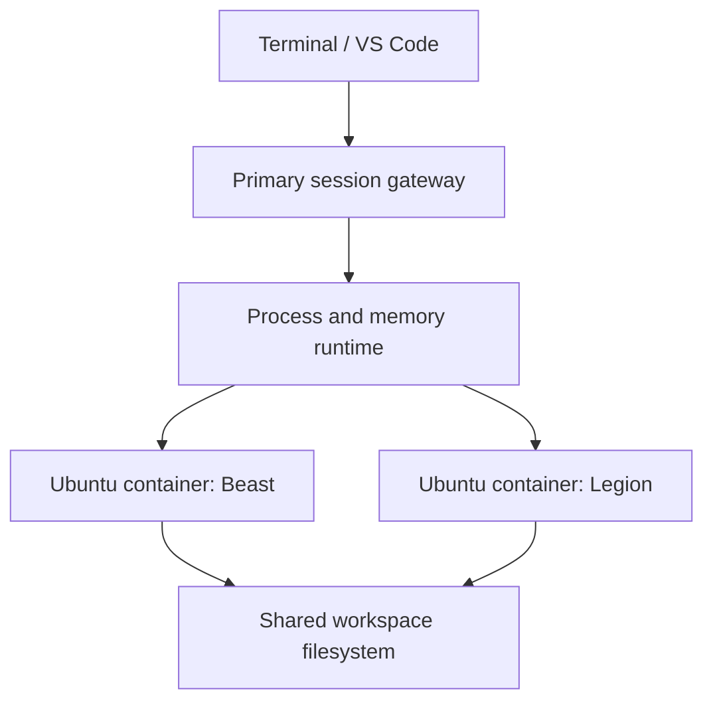

# RFC: one development session spanning Beast and Legion

Status: proposed architecture, with an isolated execution/storage experiment.

## Goal and contract

A user requests one Ubuntu session spanning two machines, connects a terminal
and eventually VS Code, and uses both machines' resources. Docker supplies local
isolation; a filesystem supplies common paths; a distributed runtime supplies
cross-host execution and, in a later milestone, memory semantics.

A session is not complete merely because a dashboard adds both machines' RAM
or a scheduler places a container on one host. The original goal remains a
single operating environment spanning hosts. Each capability must be demonstrated
independently: shared files, distributed CPU work, remote memory, and GPU work.

## Responsibilities

- Hub: session membership, authenticated user admission, placement and lifecycle.
- Agent: create a resource-limited container, attach approved workspace storage,
  report capacity, execute the session runtime and reconcile local containers.
- Primary gateway: stable shell/editor entry point, working directory/environment,
  combined outputs and process identities. Its own shell initially runs on one host.
- Execution runtime: partition supported work, dispatch workers, verify results,
  propagate exits/signals and eventually provide a distributed process abstraction.
- Filesystem: shared project paths, permissions and explicit consistency policy.
- Memory runtime: remote page/object access, ownership, consistency, synchronization
  and failure semantics. This is separate from the filesystem and scheduler.

Linux containers use a host kernel; Ubuntu userspace does not turn two containers
into one kernel. A Docker quota reserves/limits local resources. It cannot by
itself make an allocation span both hosts.

## What this PR implements

`experiments/distributed-session` is a disposable, Python-standard-library
protocol experiment, independent of the Rust services. It is not wired into the
hub's existing session API. Keeping it separate makes the unification mechanism
reviewable before adding a new public contract to the Rust implementation.

1. Start a worker in an Ubuntu container on each host. Docker enforces local limits.
2. Mount the same preconfigured NFS-backed directory at `/workspace` on both.
3. A coordinator creates a random session ID and checks unique worker identities.
4. Both directions of a random workspace marker are checked before computation.
5. Split `[0, N)` into two nonempty, nonoverlapping ranges, dispatch concurrently,
   and compute `sum(i*i)` by iteration on each worker.
6. Verify identity, session, boundaries, integer partials and a closed-form oracle;
   return one result with per-node attribution only if both succeed.
7. Remove probe files, including best-effort cleanup after failure.

The marker check is a visibility preflight, not proof of full POSIX consistency.
Unique node IDs are operator assertions, not hardware attestation: the local test
uses two services on one machine. A physical two-host run is still necessary.
No performance improvement is claimed. The tiny bounded reduction proves dispatch,
not scalability. The existing Rust single-node sessions remain unchanged.

## Wire contract and state ownership

Authenticated JSON POST operations use `Authorization: Bearer <SC_TOKEN>`:

| Endpoint | Input beyond session ID | Result |
| --- | --- | --- |
| `/v1/status` | none | operator node ID and process ID |
| `/v1/probe/write` | random marker | exclusive probe-file creation |
| `/v1/probe/read` | none | marker from the shared workspace |
| `/v1/probe/delete` | none | idempotent file cleanup |
| `/v1/reduce` | integer `start`, `end` | identity, range and integer sum |

Session IDs are random 32-character lowercase hex strings. No caller-controlled
path, shell program or image is accepted. Requests are capped at 4 KiB, responses
at 16 KiB, and reductions at 2,000,000 elements. One active reduction per worker
is allowed; additional submissions receive 409. This is admission control, not
a durable queue. Workspace mount permissions remain a trusted operator boundary.

The coordinator owns only ephemeral session state. There are no retries, leases,
or durable results. Delivery is best effort; a successful result requires both
replies to pass verification. A timeout may leave the bounded worker calculation
running to completion; it does not imply cancellation. Explicit distributed
cancellation is a later milestone. Failure returns no successful partial aggregate.
Cleanup is best effort and can leave an orphan marker after a network failure.

Workers do not execute general commands, so this prototype cannot distribute an
unchanged `python train.py` or ordinary pthread process. HTTP is only appropriate
on a trusted lab network or through an encrypted tunnel; bearer auth alone does
not encrypt traffic. The Python HTTP server is a lab harness, not a public service.

## Progression toward the original abstraction

| Milestone | Acceptance evidence |
| --- | --- |
| This experiment: shared storage + distributed CPU | Same marker visible both ways; both hosts compute verified partials |
| Rust integration | Hub creates a paired session, rolls back partial creation, persists/reconciles membership; agents mount only approved storage |
| Primary Ubuntu entry point | One SSH endpoint, persistent project path, VS Code attachment, group cancellation and session cleanup |
| Remote immutable memory | Process on Beast reads a region backed by Legion; local/remote page counters and correctness under missing-page faults |
| Writable distributed memory | Explicit ownership/invalidation protocol; concurrent-write and synchronization tests; documented memory consistency |
| Distributed conventional processes/threads | Prototype against a selected runtime with defined syscall, synchronization and migration semantics |
| Distributed GPU workloads | Selected model/operator runtime uses both GPUs with measured memory and communication costs |

For remote memory, begin with an explicitly registered immutable region and a
page server. Investigate `userfaultfd` for missing-page handling; it is a mechanism,
not a complete consistency protocol. Do not claim that a remote-page experiment
also distributes CPU execution, or that CPU memory sharing pools GPU VRAM.

## Research paths to evaluate before selecting the memory implementation

- Popcorn Linux: replicated kernels and distributed execution:
  https://popcornlinux.org/overview/
- Stretch: distributed shared-memory runtime for multithreaded applications:
  https://popcornlinux.org/thrusts/stretch/index.html
- Linux `userfaultfd`: https://kernel.org/doc/html/latest/admin-guide/mm/userfaultfd.html
- Container kernel boundary: https://www.docker.com/resources/what-container/

Compatibility with current WSL2 kernels, Docker permissions and userfaultfd
configuration is an open experiment. We have not validated these research systems
on Beast/Legion, selected a memory protocol, or implemented a new Linux kernel.

## Review decisions

1. Confirm paired-container membership as the session boundary.
2. Review fixed-operation wire semantics before porting them into the Rust agents.
3. Choose storage setup/ownership and the lifetime of persistent workspace data.
4. Select the remote-memory experiment independently of the CPU dispatch milestone.
5. Run the two-host acceptance procedure before publishing any hardware-unification
   or performance claim.
