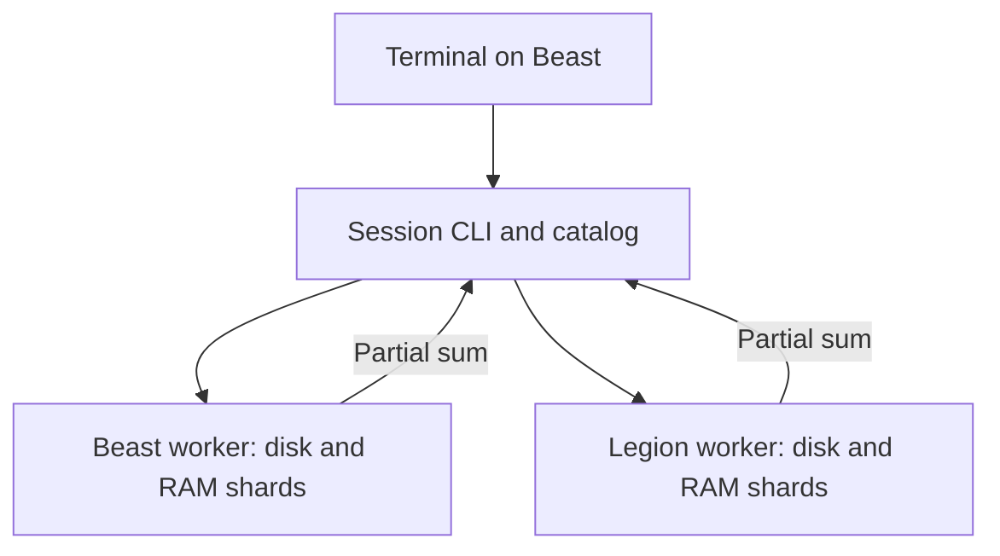

# Unified session: distributed files, RAM and compute

One terminal command creates a session across two or more workers. The session
has a distributed file namespace, byte-addressed RAM allocations and a compute
operation that runs where the data already lives. It requires no shared NFS mount.

This is a userspace prototype beside the existing Rust hub/agent. It deliberately
has no per-session CPU, RAM or disk quotas. A 1 MiB shard size bounds individual
requests; it does not cap the size of a session or allocation.



| Resource | What this session provides |
| --- | --- |
| Distributed files | `put`, `get`, `list`, and `rm disk` on a logical path. Files are striped across separate worker volumes and reconstructed in order. |
| Uniform RAM interface | `alloc` creates one zero-initialized logical buffer across worker processes. `write` and `read` use byte offsets; a range can span both hosts. `rm ram` releases it. |
| Compute | `sum disk NAME` or `sum ram NAME` runs a byte-sum on each shard owner in parallel across hosts and combines the partials. The input stays on its owners. |

File operations are CLI operations, not a POSIX or FUSE mount. RAM buffers are
explicit byte ranges, not ordinary Linux pointers or extra memory visible to
`malloc`. Worker-process memory can be paged by the host OS. The byte-sum is the
first supported compute kernel; shell processes and GPU jobs are not distributed
by this prototype. See the [architecture RFC](../../docs/distributed-session-rfc.md)
for the larger session, paging and editor goals.

## Run on Beast and Legion

Use the same checkout of this PR on both machines. Use a Linux shell (WSL on
Beast) with Docker Compose v2 and Python 3.10+ for the CLI. The two workers can
run independently; each stores its own disk shards in its Docker data volume.

1. On Beast, generate a token once and export it:

   ```bash
   export SC_TOKEN="$(python3 -c 'import secrets; print(secrets.token_hex(32))')"
   ```

   Set the same token on Legion using your existing secure channel. Keep it out
   of Git. In Bash, `read -rs SC_TOKEN; export SC_TOKEN` reads it without echoing.

2. From `experiments/unified-session` on each machine, start the worker. Use
   `legion` instead of `beast` on Legion:

   ```bash
   export SC_NODE_ID=beast
   docker compose up --build -d
   docker compose ps
   ```

3. From a second terminal on Beast, forward Legion's loopback worker port.
   Use an existing SSH alias or the LAN IP from the earlier benchmark:

   ```bash
   ssh -o ExitOnForwardFailure=yes -N -L 127.0.0.1:7354:127.0.0.1:7353 hotson@192.168.0.10
   ```

   Keep this open. Both worker endpoints bind to loopback by default. The token
   authenticates HTTP but does not encrypt it; the SSH tunnel protects traffic
   to Legion. The prototype assumes one trusted operator.

4. In Beast's original terminal, create and exercise a session:

   ```bash
   demo_dir="$(mktemp -d)"
   sc() { python3 -B session.py --state "$demo_dir/session.json" "$@"; }

   sc start http://127.0.0.1:7353 http://127.0.0.1:7354
   python3 -c 'import sys; from pathlib import Path; Path(sys.argv[1]).write_bytes(bytes([7]) * 2097152)' "$demo_dir/input.bin"

   sc put inputs/demo.bin "$demo_dir/input.bin"
   sc get inputs/demo.bin "$demo_dir/from-disk.bin"
   cmp "$demo_dir/input.bin" "$demo_dir/from-disk.bin"
   sc sum disk inputs/demo.bin

   sc alloc demo-buffer 2097152
   sc write demo-buffer 0 "$demo_dir/input.bin"
   sc read demo-buffer 0 2097152 "$demo_dir/from-ram.bin"
   cmp "$demo_dir/input.bin" "$demo_dir/from-ram.bin"
   sc sum ram demo-buffer
   sc list
   ```

   Both objects should show **1,048,576 bytes on each host**. Each sum should
   return **14,680,064**, with **7,340,032** contributed by each host.

5. Run `sc close` while both workers are reachable to delete that session's
   disk and RAM shards. It preserves the local input and downloaded files.
   Then use `docker compose down` on each host to stop the workers.

## Failure behavior

- The CLI keeps an atomic local catalog of paths, allocations, shard IDs,
  owners and SHA-256 digests. Keep that catalog on Beast: it is required to
  reconstruct the data. CLI commands using the same catalog serialize via a
  local lock. Do not copy the catalog and operate both copies independently.
- An upload or RAM write stages new shards before publishing its catalog entry.
  A partial upload leaves the old state visible; a failed download leaves no
  output file. Cleanup is best effort. Closing a session removes its orphaned
  shards as well. If a worker is down during close, restore it and retry close.
- Disk shards survive a worker restart if its volume is preserved. RAM shards
  on that worker are lost; reads and compute fail when they hit missing shards.
  No replication or failover is implemented. A small object may fit on just one
  worker; use at least two shards to exercise both hosts.
- The worker IDs in results are configured names. For hardware acceptance,
  verify the worker containers on both machines. Local tests use separate
  loopback worker services and separate disk directories on one machine.

## Local verification

```bash
python3 -B -m unittest discover -s experiments/unified-session -v
```

The suite exercises file striping, cross-node RAM writes and reads, per-node
compute, upload rollback, partial-write rollback, authentication, session
cleanup, restart semantics, and the CLI. Physical Docker deployment remains
a separate acceptance step.
